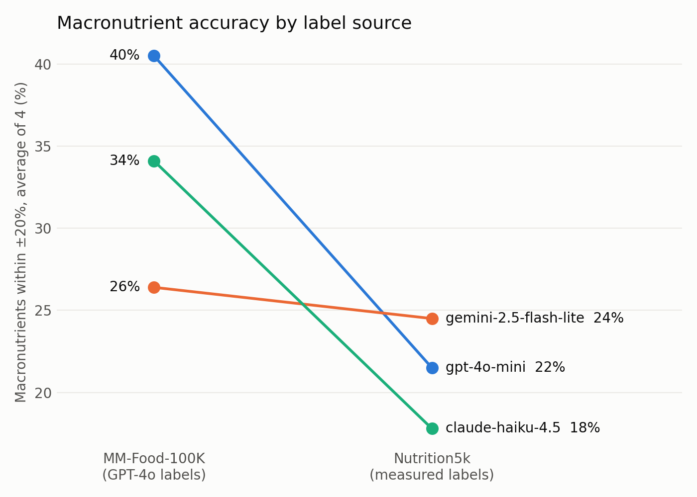
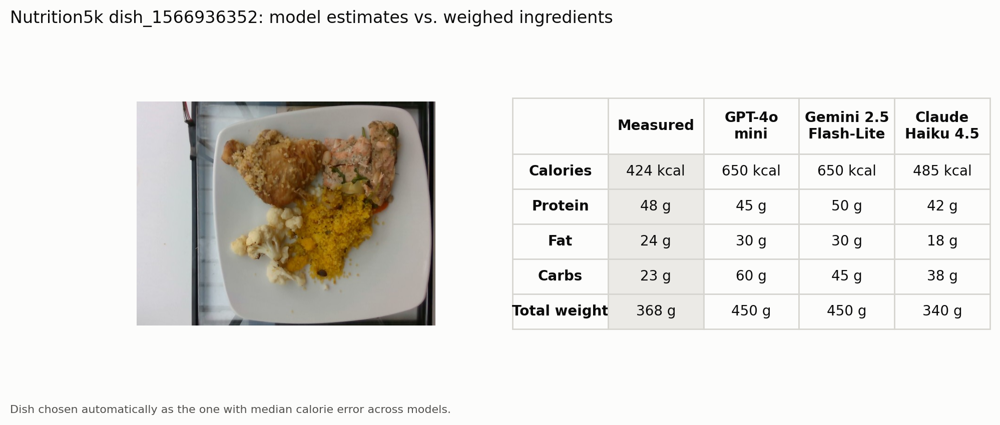

# Food Vision LLM Eval

How accurately can low-cost vision LLMs estimate nutrition from a food photo, and can we
trust the benchmark that answers that question?

This started as my team's UBC ECE capstone benchmark. Re-analysing it, I found that the
dataset's "ground truth" was itself generated by GPT-4o, so I rebuilt the evaluation and
re-ran it against measured labels.

## Key findings

- **The benchmark was grading models against GPT-4o.** MM-Food-100K's nutrition labels
  were generated by GPT-4o, not measured. On those labels GPT-4o mini's error was less than
  half of the other models'.
- **That lead disappears on measured labels.** On Nutrition5k (weighed ingredients),
  GPT-4o mini was significantly *worse* than Gemini 2.5 Flash-Lite, and the three models
  were close overall.
- **Real accuracy is low, and every model overestimates.** Only 18–25% of macronutrient
  estimates fell within ±20% of measured values; median errors were +32% to +80%.
- **The cheapest model was not worse.** Gemini 2.5 Flash-Lite cost about 20× less per image
  than GPT-4o mini, because GPT-4o mini counts images as many input tokens.



| | GPT-4o mini | Gemini 2.5 Flash-Lite | Claude Haiku 4.5 |
|---|---|---|---|
| Macro PMAE, GPT-4o labels (lower is better) | **33.9%** | 82.3% | 69.8% |
| Macro PMAE, measured labels (lower is better) | 60.3% | **52.2%** | 57.4% |
| Cost per image | $0.0022 | **$0.0001** | $0.0016 |

PMAE is mean absolute error as a percentage of the mean label value, the metric used in
the Nutrition5k paper. 100 images per dataset, paired bootstrap 95% CIs. Total API cost for
the re-run: $0.94. Full analysis, confidence intervals and limitations: **[docs/FINDINGS.md](docs/FINDINGS.md)**.

### Example



## What I did

The capstone was a 5-person project for a health-tech startup; three of us worked on the
benchmark. I wrote the benchmarking code and analysed the results. After graduating I
rebuilt it as this repository:

1. **Audited the original evaluation.** Fixed lenient scoring (e.g. empty predictions
   could count as correct), replaced a report chart that used hard-coded scores with
   generated ones, and found few-shot example values leaking into model outputs.
2. **Investigated suspicious agreement.** GPT-4o mini returned the exact label value for
   27% of images, which led me to confirm the labels were GPT-4o-generated.
3. **Re-ran against measured labels.** Replaced two retired models, removed the few-shot
   values from the prompt, sampled images randomly, and kept aspect ratios.
4. **Reported uncertainty.** Paired bootstrap CIs, PMAE alongside a ±20% hit rate, and an
   accuracy curve across tolerances so no single cut-off drives the conclusion.

## How it works

```
data/manifests/*.jsonl      images + labels (MM-Food-100K, Nutrition5k)
        │
scripts/run_benchmark.py    calls every model in configs/models.yaml
        │                   resumable, retries, cost cap, saves raw replies
results/runs/               one JSONL per dataset x model
        │
src/compare.py              scoring (src/scoring.py), PMAE, bootstrap CIs, charts
        │
results/rerun_summary.md, docs/assets/*.png
```

Models are defined in `configs/models.yaml`, so a retired model is a one-line change.

## Reproduce

```bash
pip install -r requirements.txt
cp .env.example .env              # add OPENAI_API_KEY, ANTHROPIC_API_KEY, GEMINI_API_KEY

python -m pytest -q                                      # scoring and parsing tests
python scripts/smoke_test.py path/to/food.jpg            # try all models on one photo
python scripts/prepare_data.py --n 100 --seed 42         # download images
python scripts/run_benchmark.py --dataset all            # about $1 and 40 minutes
python -m src.compare                                    # tables, CIs, charts
python scripts/make_demo.py                              # example image
```

Re-scoring needs no API calls: `results/` already contains every model reply.

## Repository layout

```
configs/      models under test and their prices
src/          providers, prompt, parsing, scoring, reports
scripts/      data prep, benchmark runner, smoke test, demo image
data/         label manifests (images are downloaded, not committed)
results/      raw and cleaned model outputs, summary tables
docs/         FINDINGS.md and charts
archive/      original capstone notebooks, kept for provenance
tests/        unit tests for scoring and JSON parsing
```

## Limitations

100 images per dataset and one run per model, so small differences are not significant.
Claude runs at default sampling because Anthropic's current API no longer accepts
`temperature`. Nutrition5k has only overhead cafeteria photos. See
[FINDINGS.md](docs/FINDINGS.md#limitations-of-the-re-run).

## Data

- [Nutrition5k](https://github.com/google-research-datasets/Nutrition5k) (Thames et al., CVPR 2021): measured labels.
- [MM-Food-100K](https://huggingface.co/datasets/Codatta/MM-Food-100K): labels generated by GPT-4o.
- The original capstone also used a fruit and vegetable image dataset from Hugging Face.

Images are not redistributed here; `scripts/prepare_data.py` downloads them from the sources.