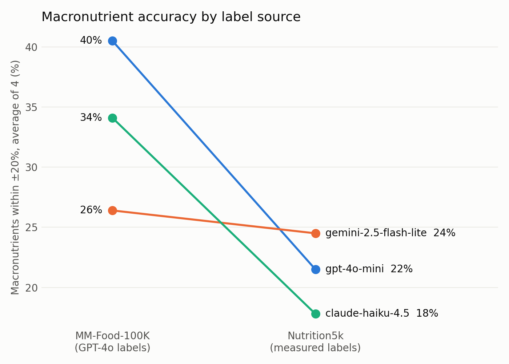
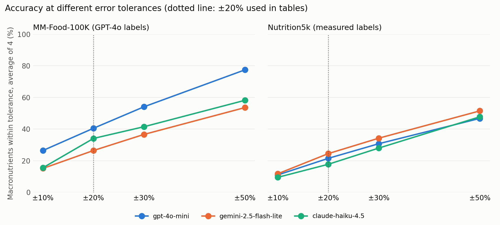

# Findings

Two parts:

1. **Re-run on GPT-4o vs measured labels (Oct 2026)**: same 3-model comparison on
   MM-Food-100K and Nutrition5k. Reproduce with `python -m src.compare`.
2. **Re-analysis of the original capstone runs (May 2026)**. Reproduce with
   `python -m src.report`.

## Part 1. Re-run: does the model ranking survive measured labels?

### Why a re-run

Part 2 found that MM-Food-100K's nutrition labels were generated by GPT-4o, so the
original benchmark measured agreement with GPT-4o. To measure real accuracy, I ran
the same models on Nutrition5k, whose labels come from weighed ingredients.
Two of the original models (Claude 3 Haiku, Gemini 2.0 Flash-Lite) had been retired,
so I used each provider's current low-cost model.

| | |
|---|---|
| Models | GPT-4o mini, Gemini 2.5 Flash-Lite, Claude Haiku 4.5 |
| Images | 100 random images per dataset (seed 42), longest side resized to 768 px, aspect ratio kept |
| Prompt | Zero-shot, schema described in words (no example values), JSON output |
| Uncertainty | Paired bootstrap over images, 2,000 resamples, 95% CI |
| Total API cost | $0.94 for 600 calls |

Main metric is **PMAE**: mean absolute error as a percentage of the mean label value,
the metric used in the Nutrition5k paper. Lower is better. I also report the share of
predictions within ±20% of the label, the tolerance the FDA allows on packaged-food
nutrition labels.

### Results

Macro PMAE = average PMAE over calories, protein, fat and carbs.

| | GPT-4o mini | Gemini 2.5 Flash-Lite | Claude Haiku 4.5 |
|---|---|---|---|
| **MM-Food-100K (GPT-4o labels)** | | | |
| Macro PMAE (lower is better) | **33.9%** | 82.3% | 69.8% |
| Macronutrients within ±20% | **40.5%** | 26.4% | 34.1% |
| **Nutrition5k (measured labels)** | | | |
| Macro PMAE (lower is better) | 60.3% | **52.2%** | 57.4% |
| Macronutrients within ±20% | 21.5% | **24.5%** | 17.8% |
| Calorie error (MAE) | 112 kcal | 107 kcal | 115 kcal |
| **Cost per image** | $0.0022 | **$0.0001** | $0.0016 |

### What the confidence intervals support

1. **GPT-4o mini's lead exists only on GPT-4o-generated labels.** On MM-Food-100K
   its PMAE is less than half of the other two models' (significant against both).
   On Nutrition5k the lead disappears, and GPT-4o mini is significantly *worse* than
   Gemini 2.5 Flash-Lite (PMAE +8.1 points, 95% CI +1.6 to +14.6).
2. **On measured labels, the three models are close.** Gemini 2.5 Flash-Lite ranks
   first on both metrics, but only some pairwise differences are significant, and the
   order of GPT-4o mini and Claude Haiku 4.5 flips depending on the metric. The safe
   conclusion is "Gemini is at least as accurate as the others", not "Gemini is the
   most accurate".
3. **Real accuracy is much lower than the GPT-4o labels suggest.** Only 18–25% of
   macronutrient estimates are within ±20% of measured values.
4. **All models overestimate measured nutrition.** Median errors are +32% to +45% for
   calories, protein and fat, and +43% to +80% for carbs. A likely cause (not yet tested):
   Nutrition5k shows small cafeteria portions from overhead with no size reference,
   and models seem to assume restaurant-sized servings.
5. **General-purpose LLMs are far behind a dedicated model.** Calorie PMAE is 44–47%,
   versus 26.1% reported for the Nutrition5k paper's RGB-only model trained on that
   dataset. This is indicative only: the paper used its official test split, not my
   100-image sample.
6. **The cheapest model is not worse.** Gemini 2.5 Flash-Lite costs about 20× less per
   image than GPT-4o mini. GPT-4o mini has the lowest price per text token but counts
   images as many tokens (about 25,000 input tokens for one 800×534 photo vs 421 for
   Gemini), which makes it the most expensive per image.

The ±20% cut-off does not drive these conclusions; see the accuracy curve at 10–50% tolerance:

Full tables: `results/rerun_summary.md`. Confidence intervals: `results/rerun_significance.md`.

### Limitations of the re-run

- 100 images per dataset and one run per model; small differences are not significant.
- Claude runs at default sampling: Anthropic's API version 2026-10-21 rejects the
  `temperature` parameter, so Claude could not be set to temperature 0 like the others.
- Nutrition5k contains only overhead photos of cafeteria dishes; results may not
  transfer to phone photos of home or restaurant meals.

## Part 2. Re-analysis of the original capstone runs (May 2026)

### Setup

| | |
|---|---|
| Models | GPT-4o mini, Gemini 2.0 Flash-Lite, Claude 3 Haiku (temperature 0, one run each) |
| Processed foods | First 400 restaurant / home-cooked / packaged / snack images from MM-Food-100K |
| Simple foods | 100 images from a fruit & vegetable recognition dataset (dish name only; no nutrition labels) |
| Prompt | Same few-shot prompt for all models, JSON output |
| Tolerance | A value counts as correct if it is within ±20% of the label |

### Key finding: the "ground truth" was generated by GPT-4o

While investigating why many predictions matched the labels *exactly*, I checked
how MM-Food-100K was labelled. The dataset maintainers confirmed in a
[Hugging Face discussion](https://huggingface.co/datasets/Humanbased-AI/MM-Food-100K/discussions/3)
that portion, calorie and macro labels were produced by GPT-4o from the image and
contributor notes, not measured.

This changes what the benchmark measures:

- It measures **agreement with GPT-4o**, not nutritional accuracy.
- It is biased toward GPT-4o mini, a model from the same family. GPT-4o mini
  returned the exact label calorie value for 27% of images, versus 18% for
  Gemini and 9% for Claude.
- Claude 3 Haiku's lower scores may partly reflect disagreement with GPT-4o
  rather than worse real-world accuracy. This cannot be separated with these labels.

This was tested in Part 1.

### Results on MM-Food-100K (agreement with GPT-4o labels)

| Metric | GPT-4o mini | Gemini 2.0 Flash-Lite | Claude 3 Haiku |
|---|---|---|---|
| Dish name match | 55% | 42% | 31% |
| Cooking method match | 88% | 87% | 73% |
| Total portion within ±20% | 24% | 28% | 25% |
| Calories within ±20% | 52% | 53% | 33% |
| Protein within ±20% | 55% | 58% | 45% |
| Fat within ±20% | 41% | 37% | 31% |
| Carbs within ±20% | 44% | 49% | 28% |

Simple foods (dish name only): GPT-4o mini 92%, Gemini 94%, Claude 88% (n = 100).

### Other findings

1. **Portion size is hard for every model.** Only about a quarter of total plate
   weights fall within ±20%, with little difference between models. Portion
   estimation from a single photo, not the model choice, is the bottleneck.
2. **Errors are biased, not random.** GPT-4o mini and Claude 3 Haiku
   systematically estimate lower values than the labels (median −12% to −27%
   across nutrients). Gemini's median error is about 0% except fat (+20%).
3. **Few-shot examples leak into outputs.** 20 of 399 Claude 3 Haiku responses
   reproduced the exact macros of the prompt's "fried chicken" example
   (450 kcal / 28 g / 25 g / 22 g), versus 2 for GPT-4o mini and 1 for Gemini.

### Fixes to the original evaluation code

| Issue in capstone version | Fix |
|---|---|
| Dish names counted as correct if they shared one word, and empty predictions could match | Correct only if one name's tokens are a subset of the other's |
| Portion counted as correct when no gram value was given | Compare total plate grams; unscorable records are excluded |
| Nutrients with a label of 0 counted as wrong | Excluded from scoring |
| Final report chart used hard-coded scores | All tables and charts generated from logs |

### Limitations

- One run per model at temperature 0; no confidence intervals yet.
- The processed sample is the first 400 rows, not a random sample.
- Images were resized to 384×384 without preserving aspect ratio.
- Latency was not measured reliably because of free-tier rate limits.